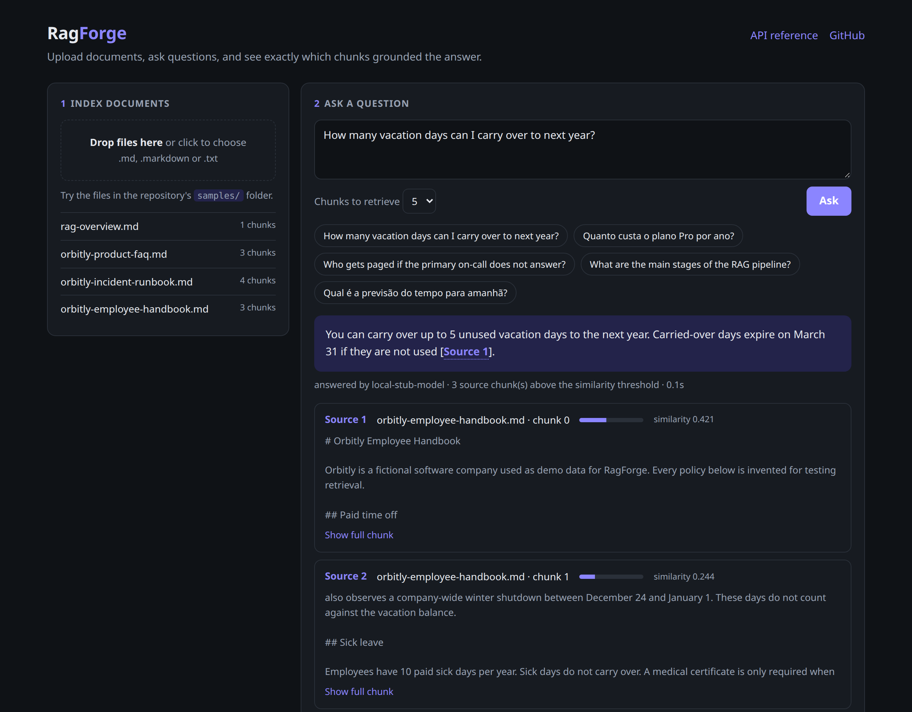
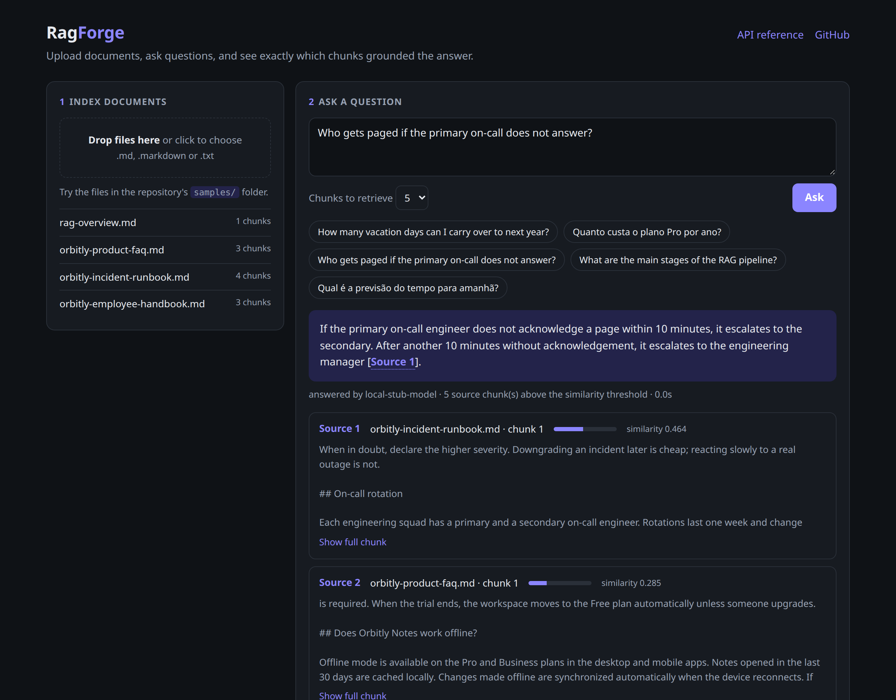
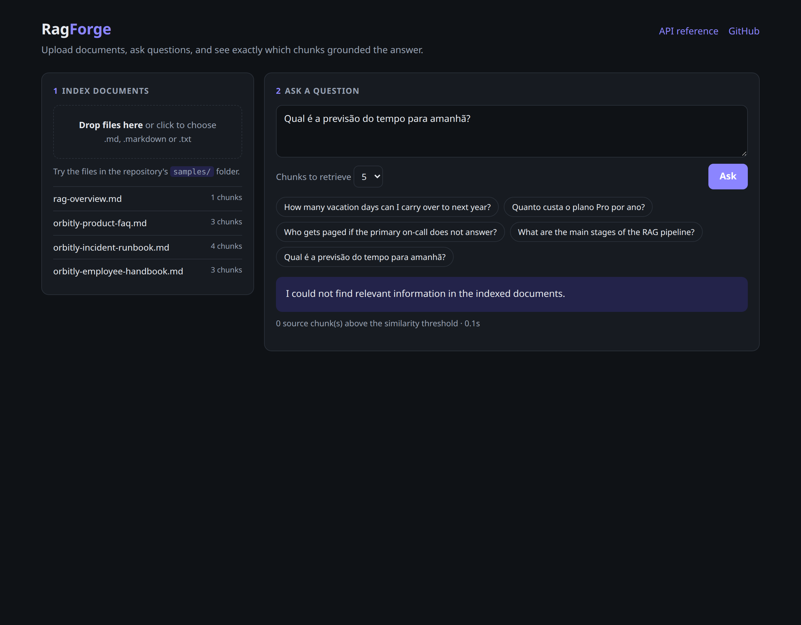

# RagForge API

[](https://github.com/lucastafer/RagForge/actions/workflows/ci.yml)

A compact Retrieval-Augmented Generation (RAG) API built with .NET, PostgreSQL, and pgvector. The chat model is pluggable: **OpenAI**, **Claude (Anthropic)**, or **DeepSeek**, selected by configuration. Embeddings use any OpenAI-compatible endpoint.



RagForge ingests text or Markdown files, splits them into overlapping chunks, creates embeddings, stores vectors in PostgreSQL, retrieves the most relevant evidence for a question, and produces a grounded answer with the exact source chunks used. A small built-in web page lets you upload documents, ask questions, and inspect the retrieved chunks and their similarity scores.

## Demo

| Retrieval picks the right document | Unrelated questions never reach the chat model |
| --- | --- |
|  |  |

_Screenshots use the fictional documents in [`samples/`](samples) and a local stub provider with canned answers, so no API key was involved. With a real provider, the "answered by" line shows the configured model._

## Why this project

This repository demonstrates practical backend and AI integration skills without hiding the core RAG flow behind a framework. It uses async I/O, dependency injection, EF Core, vector similarity search, configuration validation, API error responses, automated tests, and CI while keeping the architecture intentionally small.

**Portfolio description:** Built a retrieval-augmented generation API in ASP.NET Core that ingests Markdown/text documents, generates OpenAI-compatible embeddings, performs cosine similarity search with PostgreSQL/pgvector, and returns grounded answers with auditable source chunks from a configurable chat provider (OpenAI, Claude, or DeepSeek).

## Quick start (Docker)

Prerequisites: Docker, an OpenAI API key for embeddings, and an API key for the chat provider you choose (it can be the same OpenAI key).

```bash
cp .env.example .env
```

Edit `.env`: set `Embedding__ApiKey`, pick one chat provider block (`Chat__Provider` and `Chat__ApiKey`), and replace the sample PostgreSQL password. Then start PostgreSQL and the API:

```bash
docker compose up --build -d
```

Open `http://localhost:5190`, drop the files from [`samples/`](samples) into the upload area, and click one of the suggested questions.

## Architecture

```text
HTTP request
    │
    ▼
RagForge.Api              Controllers, validation, demo page, configuration
    │
    ▼
RagForge.Application      DTOs, interfaces, use cases, chunking
    │
    ▼
RagForge.Domain           Entities and business invariants
    ▲
    │
RagForge.Infrastructure   EF Core/pgvector store, embedding client, chat clients
    │
    ├── PostgreSQL + pgvector
    └── Embeddings and chat provider
```

The layout follows the same pattern as HookForge: `Api`, `Application`, `Domain`, and `Infrastructure`. API composes the application, Application orchestrates use cases, Domain owns entities and invariants, and Infrastructure implements external integrations. There is no MediatR, Redis, message queue, or background worker in the MVP.

## RAG flow

1. Upload a `.txt`, `.md`, or `.markdown` file.
2. Hash the content with SHA-256; if the same content was already indexed, return the existing document without calling the provider again.
3. Split the text into configurable overlapping chunks.
4. Send chunks to the configured embeddings endpoint in batches (100 inputs per request by default).
5. Persist document metadata, chunks, and vectors through EF Core.
6. Embed a question and run exact cosine-distance search in pgvector.
7. Drop chunks below the minimum similarity. If nothing relevant is left, answer "not found" without calling the chat model.
8. Send the remaining evidence to the configured chat provider (OpenAI, Claude, or DeepSeek) with grounding instructions, answering in the language of the question.
9. Return the answer plus document IDs, chunk IDs, content, and similarity scores.

Exact search is a good fit for this small demo and supports embedding models with different dimensions. For a larger corpus, choose one embedding dimension, change the column to `vector(n)`, and add an HNSW cosine index.

## Stack

- .NET 10 and ASP.NET Core Web API
- Entity Framework Core with Npgsql
- PostgreSQL 17 with pgvector
- OpenAI-compatible `/embeddings` and `/chat/completions` endpoints (OpenAI, DeepSeek)
- Official [Anthropic C# SDK](https://github.com/anthropics/anthropic-sdk-csharp) for Claude
- OpenAPI with a [Scalar](https://github.com/scalar/scalar) API reference
- xUnit, Docker Compose, and GitHub Actions

## Run locally with the .NET SDK

Prerequisites: [.NET 10 SDK](https://dotnet.microsoft.com/download/dotnet/10.0), Docker, an OpenAI API key for embeddings, and an API key for the chat provider you choose.

```bash
cp .env.example .env
```

Edit `.env`: replace the sample PostgreSQL password, set `Embedding__ApiKey`, and pick one chat provider block. Keep the embedding model unchanged after ingesting documents; vectors from different models may have incompatible dimensions or semantics. Changing the chat provider is always safe and needs no re-indexing.

PostgreSQL is exposed on host port `5433` by default so it can coexist with another local PostgreSQL on `5432`. Change both `POSTGRES_PORT` and the connection-string port if needed.

Start only PostgreSQL:

```bash
docker compose up -d postgres
```

Load the local environment, restore dependencies, and start the API:

```bash
set -a
source .env
set +a
dotnet restore RagForge.sln
dotnet run --project src/RagForge.Api
```

The API listens on `http://localhost:5190`. On first startup, EF Core creates the pgvector extension and demo schema automatically.

- Demo page: `http://localhost:5190`
- API reference (Scalar): `http://localhost:5190/scalar`
- OpenAPI document: `http://localhost:5190/openapi/v1.json`

You can also execute the ready-made requests in `RagForge.http` from Rider, Visual Studio, or VS Code with a REST Client extension.

Alternatively, keep the API key in .NET user secrets instead of `.env`:

```bash
dotnet user-secrets set "Embedding:ApiKey" "your-openai-key" --project src/RagForge.Api
dotnet user-secrets set "Chat:ApiKey" "your-chat-provider-key" --project src/RagForge.Api
```

## Endpoints

### Health

```http
GET /health
```

### List indexed documents

```http
GET /api/documents
```

### Ingest a document

```http
POST /api/documents
Content-Type: multipart/form-data
```

```bash
curl -X POST http://localhost:5190/api/documents \
  -F "file=@samples/orbitly-employee-handbook.md;type=text/markdown"
```

Example response (`201 Created`):

```json
{
  "documentId": "4a7cf45d-6641-4dc6-bab2-599fc9a1950d",
  "name": "orbitly-employee-handbook.md",
  "chunkCount": 3,
  "alreadyIndexed": false
}
```

Uploading the same content again returns `200 OK` with the existing document and `"alreadyIndexed": true`.

### Ask a question

```http
POST /api/questions
Content-Type: application/json
```

```bash
curl -X POST http://localhost:5190/api/questions \
  -H "Content-Type: application/json" \
  -d '{"question":"How many vacation days can I carry over to next year?","topK":5}'
```

The response contains `answer` and `sources`. Each source includes the document and chunk identifiers, document name, chunk index, retrieved content, and cosine similarity score.

## Demo data

[`samples/`](samples) contains a small corpus about a fictional company, Orbitly, plus a short RAG overview. Each file covers a different subject, so you can see retrieval pick the right document:

| File | Try asking |
| --- | --- |
| `orbitly-employee-handbook.md` | How many vacation days can I carry over to next year? |
| `orbitly-product-faq.md` | Quanto custa o plano Pro por ano? |
| `orbitly-incident-runbook.md` | Who gets paged if the primary on-call does not answer? |
| `rag-overview.md` | What are the main stages of the RAG pipeline? |

Asking something unrelated, such as the weather tomorrow, should return no sources and a "not found" answer, because no chunk passes the similarity threshold.

## How to verify the RAG flow

1. Start PostgreSQL and the API.
2. Upload the files from `samples/` through the demo page or `RagForge.http`.
3. Confirm each upload reports a non-zero chunk count, and that uploading a file twice reports it as already indexed.
4. Ask `How many vacation days can I carry over to next year?`.
5. Confirm the answer mentions 5 days and cites `[Source N]`, and that the top source comes from `orbitly-employee-handbook.md`.
6. Ask the same kind of question in Portuguese and confirm the answer comes back in Portuguese.

That validates the complete path: file upload → chunking → embeddings → PostgreSQL/pgvector → vector retrieval → grounded chat answer → source response.

## Providers

RagForge talks to two independent services, configured separately:

- **Embeddings** (`Embedding__*`): any OpenAI-compatible `/embeddings` endpoint. Neither the Claude API nor DeepSeek offers embeddings, so this stays on OpenAI (or another compatible service) whichever chat model you use.
- **Chat** (`Chat__*`): the model that writes the grounded answer. Set `Chat__Provider` and `Chat__ApiKey`; the model and base URL have per-provider defaults.

| `Chat__Provider` | API used | Default `Chat__Model` | Low-cost alternative |
| --- | --- | --- | --- |
| `OpenAI` | `https://api.openai.com/v1/chat/completions` | `gpt-4o-mini` | — |
| `Anthropic` | Claude Messages API through the official SDK | `claude-opus-5-5` | `claude-haiku-5-5` |
| `DeepSeek` | `https://api.deepseek.com/chat/completions` | `deepseek-v4-pro` | `deepseek-flash` |

Example: Claude for answers, OpenAI for embeddings.

```bash
Embedding__ApiKey="sk-..."          # OpenAI key
Chat__Provider="Anthropic"
Chat__ApiKey="sk-ant-..."
Chat__Model="claude-haiku-5-5"      # optional
```

Any other service that implements the OpenAI chat-completions format (a local model server, for example) works with `Chat__Provider=OpenAI` plus `Chat__BaseUrl` and `Chat__Model`. The same applies to `Embedding__BaseUrl` and `Embedding__Model`.

API keys must never be committed. A ChatGPT or Claude subscription does not include API usage; API billing is managed separately on each provider's developer platform.

Provider failures are translated into clear problem responses that name the failing side (`Embedding` or `Chat`): an invalid key returns `502` with "AI provider rejected the credentials", an exhausted quota or rate limit returns `503`, and a provider timeout returns `504`. The response to a question includes `chatModel`, the model that wrote the answer.

## Configuration

ASP.NET Core environment variables use double underscores for nested keys.

| Setting | Purpose | Default |
| --- | --- | --- |
| `ConnectionStrings__DefaultConnection` | PostgreSQL connection | Required |
| `Embedding__ApiKey` | Embeddings credential | Required |
| `Embedding__BaseUrl` | OpenAI-compatible API root for embeddings | `https://api.openai.com/v1/` |
| `Embedding__Model` | Embedding model | `text-embedding-3-small` |
| `Embedding__BatchSize` | Inputs per embeddings request | `100` |
| `Embedding__TimeoutSeconds` | Embeddings request timeout | `60` |
| `Chat__Provider` | `OpenAI`, `Anthropic`, or `DeepSeek` | `OpenAI` |
| `Chat__ApiKey` | Chat provider credential | Required |
| `Chat__Model` | Chat model | Provider default (see above) |
| `Chat__BaseUrl` | Override the chat API root | Provider default |
| `Chat__Temperature` | Sampling temperature for OpenAI-compatible providers | Not sent |
| `Chat__TimeoutSeconds` | Chat request timeout | `120` |
| `Rag__Chunking__ChunkSize` | Maximum chunk characters | `1000` |
| `Rag__Chunking__Overlap` | Overlap characters (at most half of the chunk size) | `150` |
| `Rag__Retrieval__MinSimilarity` | Minimum cosine similarity for a chunk to be used | `0.2` |
| `DocumentUpload__MaxBytes` | Maximum upload size | `5242880` |

`Chat__Temperature` is optional and never sent to Claude: reasoning models and current Claude models reject sampling parameters.

`MinSimilarity` depends on the embedding model. `0.2` works as a conservative cut-off for `text-embedding-3-small`; raise it if unrelated questions still retrieve chunks, or lower it if relevant chunks are being dropped.

## Tests

```bash
dotnet test RagForge.sln
```

- `RagForge.Application.Tests` covers chunk sizing and validation, duplicate detection, the similarity threshold, and the complete ingestion and question-answering orchestration using deterministic test doubles.
- `RagForge.Infrastructure.Tests` covers the provider clients against a fake HTTP handler: embedding batches, the OpenAI-compatible chat client (including DeepSeek defaults), the Claude client, refusals, and provider error status codes.

Database integration tests with Testcontainers are a natural next addition.

## Secret safety

- `.env`, local appsettings overrides, private keys, and certificate files are ignored by Git and Docker builds.
- Tracked `appsettings.json` contains no credential.
- `.env.example` contains placeholders only.
- .NET user secrets are supported for local development.
- The CI workflow receives no provider secret and only builds/tests code.

Before pushing, run `git diff --cached` and confirm that no real token appears in the staged changes.

## Reset the demo database

The schema is created with `EnsureCreated`, so schema changes require a fresh database. This deletes only the Docker volume created by this Compose project:

```bash
docker compose down -v
docker compose up --build -d
```

## Possible next steps

- Add PDF extraction behind an `IDocumentTextExtractor` implementation.
- Add HNSW indexing after locking the embedding dimension.
- Add document deletion and re-indexing.
- Add Testcontainers integration tests for PostgreSQL.
- Add retries with `Microsoft.Extensions.Http.Resilience` for provider rate limits.
- Stream chat responses for a richer client experience.

## References

- [pgvector-dotnet](https://github.com/pgvector/pgvector-dotnet)
- [Npgsql EF Core provider](https://www.npgsql.org/efcore/)
- [ASP.NET Core configuration](https://learn.microsoft.com/aspnet/core/fundamentals/configuration/)
